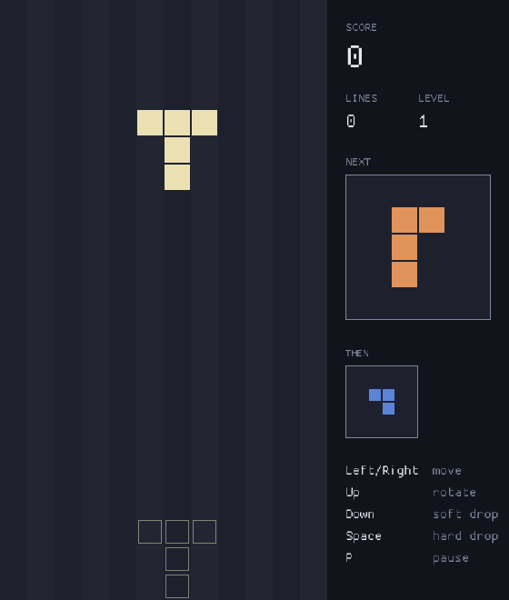

# Polyfall

<table>
<tr>
<td width="300" valign="top">

</td>
<td valign="top">

## Why

Most falling-block games hand you the same few shapes forever. After a while you stop
looking at the pieces and play from memory.

Polyfall takes the memory away. Every piece is grown at random from three to five
cells, so the shape in front of you may be one you have never placed before. The game
is about reading an unfamiliar shape quickly and finding a home for it.

It exists for short breaks at a desk:

- **Nothing to learn first.** It starts falling the moment the window opens.
- **Nothing to lose.** It pauses itself when you stop touching the keyboard, so
  leaving mid-game costs nothing.
- **Small on purpose.** One window, one keyboard, two source files. A feature has to
  earn its place.

</td>
</tr>
</table>

How it works, how to run it and how to change it are in the [documentation](docs/index.md).
