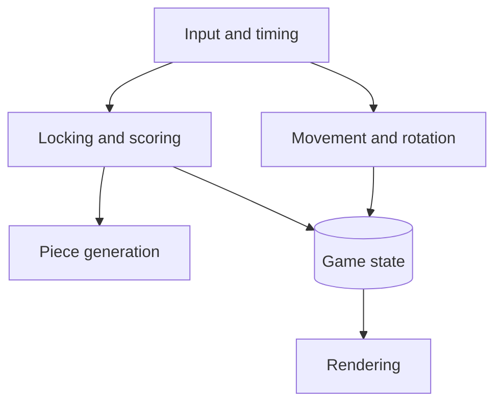
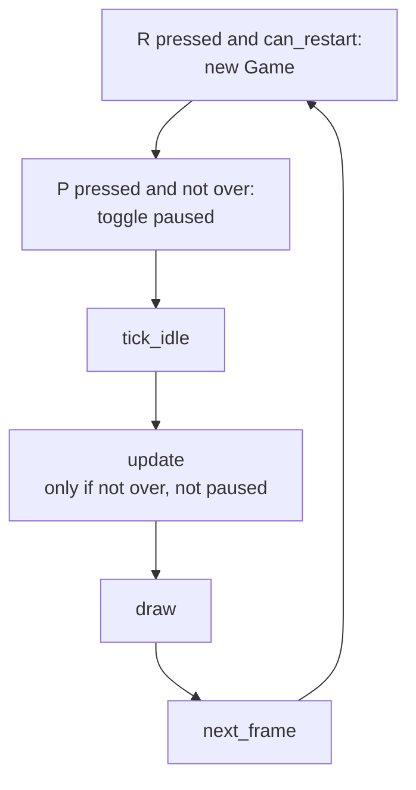

# Components (C4 level 3)

`src/main.rs` is not split into modules. The components below are groups of
functions that work on the same concern. All of them read or write one value of
type `Game`, owned by `main`.

## Component list

| Component | Functions | Responsibility | Reference |
| --- | --- | --- | --- |
| Game state | `struct Game`, `struct Piece`, `type Grid`, `Game::new` | Holds the well, three pieces, counters, timers and flags. | [Game state](../reference/game-state.md) |
| Piece generation | `random_piece` | Grows a random connected shape of 3 to 5 cells and places it at the spawn position. | [Game rules](../reference/game-rules.md) |
| Movement and rotation | `Game::fits`, `Game::shift`, `Game::landing_y`, `Game::rotate` | Collision test, translation, landing row, rotation with kicks. | [Rotation and kicks](../reference/rotation-and-kicks.md) |
| Locking and scoring | `Game::lock`, `Game::level` | Writes the piece into the grid, clears full rows, updates score, lines, feedback timers, advances the piece queue, detects game over. | [Game rules](../reference/game-rules.md) |
| Input and timing | `main`, `Game::update`, `Game::repeats`, `Game::tick_idle`, `Game::can_restart` | Reads keys, applies key repeat, gravity, pause, restart and idle auto-pause. | [Controls and timing](../reference/controls-and-timing.md) |
| Rendering | `Game::draw`, `Game::draw_well`, `Game::draw_panel`, `Game::draw_overlay`, `draw_cell`, `conf` | Sets the fixed view, draws the well, the panel and the overlays, and runs down the two feedback timers. | [Rendering and layout](../reference/rendering-and-layout.md) |

## Who calls what

| Caller | Calls |
| --- | --- |
| `main` | `Game::new`, `Game::can_restart`, `Game::tick_idle`, `Game::update`, `Game::draw` |
| `Game::new` | `random_piece` (three times) |
| `Game::update` | `Game::shift`, `Game::repeats`, `Game::rotate`, `Game::lock`, `Game::level` |
| `Game::shift`, `Game::landing_y`, `Game::rotate` | `Game::fits` |
| `Game::lock` | `Game::level`, `random_piece`, `Game::fits` |
| `Game::draw` | `Game::draw_well`, `Game::draw_panel`, `Game::draw_overlay` |
| `Game::draw_well` | `Game::landing_y`, `draw_cell` |
| `Game::draw_panel` | `Game::level` |

Functions that touch macroquad input or drawing: `main`, `Game::update` and the
`draw` family. Functions that touch only macroquad's random generator:
`random_piece`, and through it `Game::new` and `Game::lock`. Everything else is
plain computation on `Game`, which is why the tests run without a window.

## One frame

`main` seeds the random generator, builds a `Game`, then repeats this sequence
forever. There is no exit path in the code; the process ends when the window is
closed.

Consequences of this order, all readable from `main`:

- R is tested before P. If both are pressed in one frame while paused, the game
  is replaced by a new one and then P pauses the new game.
- `tick_idle` runs every frame, in every state. It can set `paused` in the same
  frame, in which case `update` is skipped in that frame.
- `draw` runs every frame, in every state. The feedback timers `flash` and
  `glow` are decremented inside `draw`, so they keep running while the game is
  paused or over.

## Inside `update`

`Game::update` runs only while the game is neither over nor paused. Its steps,
in order:

1. Horizontal move: one step on a new Left/Right press, or the repeat steps owed
   by a held key.
2. Rotation, if Up was pressed this frame.
3. Hard drop, if Space was pressed this frame: the piece is shifted down until
   it stops, `lock` is called, and `update` returns. Gravity is skipped.
4. Gravity: `fall` grows by the frame time; when it reaches the current
   interval it is reset to `0.0` and the piece moves down one row, or locks if
   it cannot.

Because steps 1 and 2 come before step 3, a move or rotation pressed in the same
frame as Space is applied before the drop.
