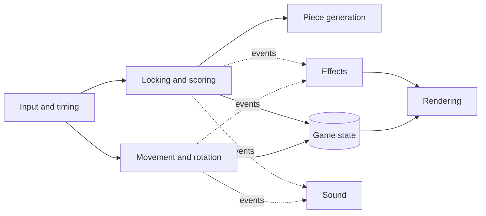
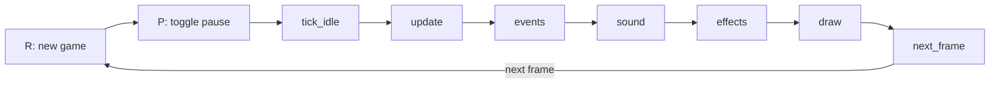

# Components (C4 level 3)

This page is the map of `src/main.rs`, `src/fx.rs` and `src/sound.rs`. Read it with the source open, before you
change anything: it tells you which functions belong together and in what order
they run.

## The idea

The whole game is one value of type `Game`, owned by `main`. `main` runs
one frame after another. In each frame it reads the keyboard, changes the `Game`
value, then draws it. Every function in the file either changes that value or
reads it.

The effects and the sound are the two exceptions. The effects live in a second
value of type `Fx`, in the module `src/fx.rs`. The sound lives in a `Desk` and
a `Speakers` value, in the module `src/sound.rs`. `main` owns them all, and the
game reads none of them.

Apart from those two modules, the components below are groups of functions that
share a concern. They are a way to read `src/main.rs`, not something the compiler
knows about.

The diagram shows the direction of data: input changes the game state through
two components, and rendering only reads it. Effects and sound hear about
changes as events. Effects are read by rendering and sound goes to the sound
card; nothing flows back from either.

## The components

| Component | Functions and types | What it does | Details |
| --- | --- | --- | --- |
| Game state | `Game`, `Piece`, `Grid`, `Event`, `Game::new` | Holds the well, the falling piece, the two upcoming pieces, the counters, the timers, the flags and the events not yet handed to the effects and the sound. | [Game state](../reference/game-state.md) |
| Piece generation | `random_piece` | Grows a random connected shape of 3 to 5 cells and places it at the top of the well. | [Game rules](../reference/game-rules.md#how-a-piece-is-made) |
| Movement and rotation | `Game::fits`, `Game::shift`, `Game::sidestep`, `Game::descend`, `Game::landing_y`, `Game::rotate` | Tests whether a piece fits, moves it sideways or down, finds its landing row and turns it. | [Rotation and kicks](../reference/rotation-and-kicks.md) |
| Locking and scoring | `Game::hard_drop`, `Game::lock`, `Game::level` | Writes the piece into the well, removes full rows, updates the score, brings in the next piece and detects the end of the game. | [Game rules](../reference/game-rules.md#locking-and-clearing-rows) |
| Input and timing | `main`, `Game::update`, `Game::repeats`, `Game::tick_idle`, `Game::can_restart` | Reads keys and applies key repeat, falling, pause, restart and the automatic pause. | [Controls and timing](../reference/controls-and-timing.md) |
| Rendering | `conf`, `Game::draw`, `Game::draw_well`, `Game::draw_panel`, `Game::draw_overlay`, `draw_piece` | Sets up the window and draws the well, the side panel and the overlays. | [Rendering and layout](../reference/rendering-and-layout.md) |
| Effects | `Fx` and everything else in `src/fx.rs` | Turns events into short-lived motion, light and fragments, and tells rendering how to draw them. | [Effects](../reference/effects.md) |
| Sound | `Desk`, `Speakers`, `Cue`, `Order` and everything else in `src/sound.rs` | Turns events into sounds: which cue, how loud, and what the theme does meanwhile. | [Sound](../reference/sound.md) |

`Game::fits` is the function everything else rests on. It answers one question:
are all these cells inside the well and on empty cells? A piece is moved or
turned only after `fits` says yes.

## Who calls what

| Caller | Calls |
| --- | --- |
| `main` | `Game::new`, `Game::can_restart`, `Game::tick_idle`, `Game::update`, `Speakers::load`, `Desk::new`, `Desk::restart`, `Desk::on`, `Desk::frame`, `Desk::orders`, `Speakers::obey`, `Fx::on`, `Fx::tick`, `Game::draw` |
| `Game::new` | `random_piece`, three times |
| `Game::update` | `Game::sidestep`, `Game::shift`, `Game::repeats`, `Game::rotate`, `Game::hard_drop`, `Game::descend`, `Game::level` |
| `Game::sidestep` | `Game::shift` |
| `Game::descend` | `Game::shift`, `Game::lock` |
| `Game::hard_drop` | `Game::landing_y`, `Game::lock` |
| `Game::shift`, `Game::landing_y`, `Game::rotate` | `Game::fits` |
| `Game::lock` | `Game::level`, `random_piece`, `Game::fits` |
| `Game::draw` | `Game::draw_well`, `Game::draw_panel`, `Game::draw_overlay` |
| `Game::draw_well` | `Game::landing_y`, `draw_piece`, `Fx::draw_under`, `Fx::block`, `Fx::draw_clear`, `Fx::piece_pose`, `Fx::draw_over` |
| `Game::draw_panel` | `Game::level`, `Fx::score`, `Fx::score_tint`, `Fx::gain`, `Fx::levelled` |
| `Game::draw_overlay` | `Fx::over_dim`, `Fx::over_box` |
| `Desk::on` | `drop_power`, which `Fx` uses too |

Only `main`, `Game::update`, `draw_piece`, the `Game::draw` family, the
three `Fx::draw_*` functions and `Speakers` call macroquad input, time, drawing or sound functions. The rest is plain computation on
`Game`, which is why the tests run without a window. See
[Development](../development.md#tests-run-without-a-window).

## One frame

`main` seeds the random generator, creates a `Game`, an `Fx` and a `Desk`,
loads the sounds into `Speakers`, then repeats the same steps forever. The code has no exit path: the process ends when the player
closes the window.

The diagram shows the fixed order of one frame. `update` is the only step that
can be skipped.

| Step | Runs when |
| --- | --- |
| R: replace the game with `Game::new()` and the effects with `Fx::default()`, and call `Desk::restart()` | R was pressed and `can_restart()` is true. |
| P: flip `paused` | P was pressed and the game is not over. |
| `tick_idle` | Every frame. |
| `update` | The game is neither over nor paused. |
| Events: pass every event in `Game::events` to `Desk::on`, then to `Fx::on` | Every frame. |
| Sound: `Desk::frame`, then `Speakers::obey` with the orders the desk wrote | Every frame. |
| Effects: `Fx::tick` | The game is not paused. |
| `draw` | Every frame. |
| `next_frame().await` | Every frame. It hands control to macroquad until the next frame. |

What follows from this order:

- `tick_idle` runs before `update`. When it pauses the game, `update` is
  skipped in that same frame.
- `draw` runs in every state and changes nothing: it takes `&self` and `&Fx`.
- Effects stop during a pause, because `Fx::tick` is skipped, and keep running
  when the game is over, so the ending can play.
- Sound runs in every state. `Desk::frame` is how the desk learns of a pause:
  it is the step that fades the theme out and back.
- R is tested before P. If both are pressed in one frame while the game is
  paused, a new game starts and P pauses it at once.

## Inside `update`

`Game::update` does the work of a frame of play. Its steps, in order:

1. **Sideways move.** One column on a new press of Left or Right, through
   `sidestep`, which reports a press that cannot move. Or the repeat moves owed
   by a held key, through `shift`, which reports nothing when it is refused.
2. **Rotation**, if Up was pressed this frame.
3. **Hard drop**, if Space was pressed this frame. `hard_drop` puts the piece
   on its landing row and calls `lock`, and `update` returns. Step 4 is skipped.
4. **Falling.** `fall` grows by the frame time. When it reaches the current
   fall interval, it returns to `0.0` and `descend` moves the piece down one
   row, or calls `lock` if it cannot move down. `descend` is told whether Down
   is held, and reports a row that fell with it held as a soft drop.

Steps 1 and 2 come before step 3, so a move or a rotation pressed in the same
frame as Space is applied before the drop.
