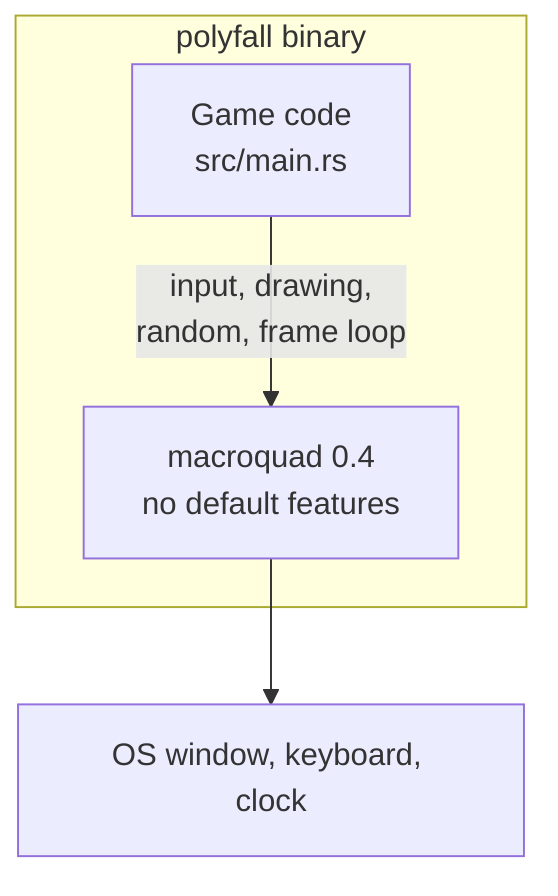

# Containers (C4 level 2)

There is one deployable unit: the `polyfall` binary (package `polyfall`, version
`0.1.0`, edition 2021). It contains the game code from `src/main.rs` and the
macroquad library, linked statically by Cargo.

## The game code

One file, `src/main.rs`. It holds constants, the `Piece` and `Game` types, the
free functions `random_piece`, `draw_cell`, `conf` and `main`, and a `tests`
module. See [Components](components.md).

## macroquad

The only direct dependency. The game uses it through `use macroquad::prelude::*`
for:

| Use | Calls found in the code |
| --- | --- |
| Program entry and frame loop | `#[macroquad::main(conf)]`, `next_frame().await`, `Conf` |
| Keyboard | `is_key_pressed`, `is_key_down`, `get_keys_down`, `KeyCode` |
| Time | `get_frame_time`, `macroquad::miniquad::date::now` |
| Random numbers | `rand::srand`, `rand::gen_range` |
| Drawing | `set_camera`, `Camera2D::from_display_rect`, `clear_background`, `draw_rectangle`, `draw_rectangle_lines`, `draw_text`, `measure_text` |
| Types | `Color`, `Rect` |

Text is drawn with `draw_text` and measured with `measure_text(line, None, ...)`,
that is, with no font argument. The program loads no font of its own.

## What is not there

These absences are facts about the source, not design statements.

| Absent | Evidence |
| --- | --- |
| Files | No `std::fs`, no path, no asset loading call. Score and state exist only in memory and are lost on exit or on restart. |
| Network | No socket or HTTP call, and no networking crate in `Cargo.lock`. |
| Audio | macroquad is built with `default-features = false`; the `Cargo.toml` comment says the default features only add audio. No sound call exists in the code. |
| Configuration | No command-line argument, environment variable or settings file is read. All tuning values are `const` items. |
| Threads or async work | `main` is `async` only because macroquad requires it; the single `await` is `next_frame()`. |
| Other input devices | No mouse, touch or gamepad call. |

## Toolchain

`mise.toml` declares two tools: `rust` (`version = "latest"`, with the option
`mr_boxington = true`) and `mr-boxington = "latest"`. Neither is referenced from
the game code.
