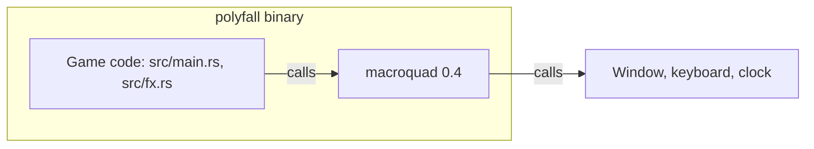

# Containers (C4 level 2)

This page shows what the program is made of when it runs. Read it to learn
which work the game code does itself and which it leaves to macroquad.

There is one unit to build and run: the `polyfall` binary (package `polyfall`,
version `0.1.0`, Rust edition 2021). Cargo links two things into it: the game
code from `src/main.rs` and `src/fx.rs`, and the macroquad library.

The diagram shows that the game code never talks to the operating system
directly: every call goes through macroquad.

## The game code

Two files. `src/fx.rs` holds the visual effects: the `Fx` type and its tests.
See [Effects](../reference/effects.md). `src/main.rs` holds the rest: the
constants, the `Piece`, `Game` and `Event` types,
the free functions `random_piece`, `draw_piece`, `conf` and `main`, and the
`tests` module. [Components](components.md) describes its parts.

## macroquad

macroquad is the only direct dependency. The game imports it with
`use macroquad::prelude::*` and uses it for five jobs:

| Job | Calls in the code |
| --- | --- |
| Program entry and frame loop | `#[macroquad::main(conf)]`, `Conf`, `next_frame().await` |
| Keyboard | `is_key_pressed`, `is_key_down`, `get_keys_down`, `KeyCode` |
| Time | `get_frame_time`, `macroquad::miniquad::date::now` |
| Random numbers | `rand::srand`, `rand::gen_range` |
| Drawing | `set_camera`, `Camera2D::from_display_rect`, `Rect`, `Color`, `clear_background`, `draw_rectangle`, `draw_rectangle_ex`, `draw_rectangle_lines`, `draw_text`, `measure_text` |

macroquad is built without its default features, which removes audio.
[Development](../development.md#audio-is-disabled) gives the reason.

The game loads no font. `draw_text` and `measure_text` use the font built into
macroquad.

## What is not there

| Absent | Evidence in the source |
| --- | --- |
| Files | No `std::fs` call, no path, no asset loading. |
| Network | No socket or HTTP call, and no networking crate in `Cargo.lock`. |
| Audio | No sound call, and macroquad is built without its audio feature. |
| Configuration | No command-line argument, environment variable or settings file is read. Every tuning value is a `const` or a literal in the code. |
| Threads and background work | `main` is `async` because macroquad requires it. Its only `await` is `next_frame()`. |
| Other input devices | No mouse, touch or gamepad call. |
