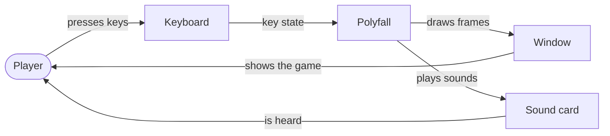

# Context (C4 level 1)

This page shows Polyfall from the outside: who uses it and what it exchanges
with the rest of the machine. Read it first to learn the limits of the program.

Polyfall has one user, the player, and three things it needs from the operating
system: a keyboard to read, a window to draw in and a sound card to play
through.

The diagram shows the only path through the program: keys go in, frames and
sound come out.

## What goes in

| Input | Read with | Used for |
| --- | --- | --- |
| The keys Left, Right, Up, Down, Space, P and R | `is_key_pressed`, `is_key_down` | Playing. See [Controls and timing](../reference/controls-and-timing.md). |
| The set of all keys held down | `get_keys_down` | Only to detect that the player is idle. |
| The time the last frame took | `get_frame_time` | Every timer in the game. |
| The system clock, once at start | `macroquad::miniquad::date::now` | The seed of the random generator. |

## What comes out

Drawn frames in one window, and sound. [Sound](../reference/sound.md) lists what
is played. `conf()` describes the window:

| `Conf` field | Value |
| --- | --- |
| `window_title` | `"Polyfall"` |
| `window_width` | `VIEW_W as i32`, which is 560 |
| `window_height` | `VIEW_H as i32`, which is 660 |
| `window_resizable` | `false` |
| `high_dpi` | `true` |

All other `Conf` fields keep their default values.

## What does not exist

The source has no mouse, touch or gamepad call, no file call and no network
call. The player has no name or account. Score and game state live
in memory and are lost when the window closes.
