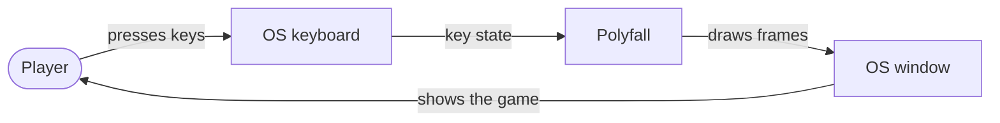

# Context (C4 level 1)

Polyfall has one kind of user and two external dependencies, both provided by
the operating system: a keyboard and a window.

## Actors and systems

| Element | Role | Evidence in the code |
| --- | --- | --- |
| Player | One person at a keyboard. `PRODUCT.md` names a single player, the author. | No player identity, account or name exists anywhere in `src/main.rs`. |
| Polyfall | The program: one process, one window. | `main`, annotated `#[macroquad::main(conf)]`. |
| OS keyboard | The only input. | `is_key_pressed`, `is_key_down`, `get_keys_down` in `main` and `Game::update`. |
| OS window | The only output. | `conf()` and the `draw_*` calls reached from `Game::draw`. |

## What crosses the boundary

Inputs read by the program:

- Key state for Left, Right, Up, Down, Space, P and R.
- The set of all keys currently held (`get_keys_down()`), used only to detect
  idleness.
- Frame time (`get_frame_time()`).
- The system clock, once, at start: `rand::srand(macroquad::miniquad::date::now() as u64)`.

Outputs produced by the program:

- Drawn frames in one window titled `Polyfall`.

Nothing else crosses the boundary. The source contains no mouse, touch or
gamepad calls, no file or network calls, and no audio calls.

## The window

`conf()` requests:

| Field | Value |
| --- | --- |
| `window_title` | `"Polyfall"` |
| `window_width` | `VIEW_W as i32` = 560 |
| `window_height` | `VIEW_H as i32` = 660 |
| `window_resizable` | `false` |
| `high_dpi` | `true` |

All other `Conf` fields keep their defaults.
