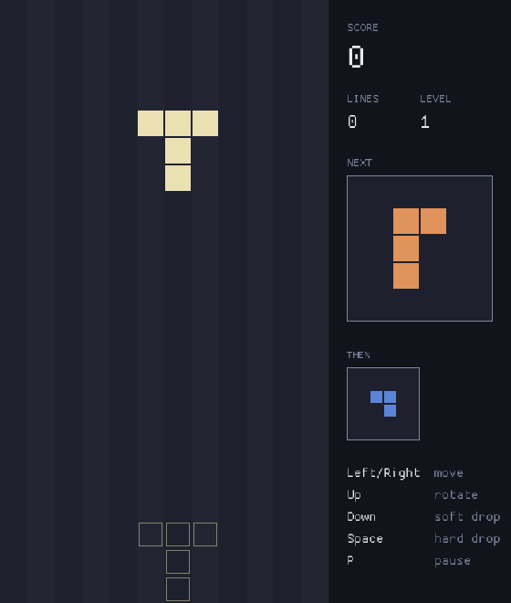

# Polyfall

This page says what the program is and where to go next. Start here if you are
new to the code.

Polyfall is a single-player falling-block puzzle game for a desktop window. It
is written in Rust with the macroquad 0.4 library. All game code, including its
unit tests, is in one file: `src/main.rs`.

## How the game plays

Pieces fall one at a time into a well of 12 columns by 22 rows. Every piece is
a random connected shape of 3, 4 or 5 cells, so there is no fixed set of shapes.
The player moves and rotates the falling piece with the keyboard. When the piece
can fall no further it locks into the well. Every full row is then removed and
scores points. Every 10 cleared rows raise the level, and each level makes
pieces fall faster. The game ends when a new piece has no room to appear.

The game pauses on P, and pauses itself after 8 seconds without a key. Nothing
is saved. There is no sound, no network access and no file access.

## Terms

These words have one meaning on every page.

| Term | Meaning |
| --- | --- |
| Well | The 12 by 22 playing area on the left of the window. |
| Cell | One square of the well, or one square of a piece. |
| Piece | A connected shape of 3 to 5 cells. The falling piece is the one the player controls. |
| Upcoming pieces | The two pieces that fall after the current one. The code names them `next` and `after`. |
| Lock | The moment the falling piece becomes part of the well. Its cells are then locked cells. |
| Stack | All the locked cells in the well. |
| Landing outline | The outline that shows where the falling piece would lock if dropped straight down. |
| Side panel | The area right of the well: score, lines, level, upcoming pieces and key list. |
| Kick | A small shift tried when a rotated piece does not fit in place. |

## Reading order

1. [Development](development.md): run the game, run the tests and build this
   documentation.
2. [Context](architecture/context.md), [Containers](architecture/containers.md)
   and [Components](architecture/components.md): the program from the outside
   in. Components is the map of `src/main.rs`; read it with the source open.
3. [Game rules](reference/game-rules.md): how pieces are made, fall, lock and
   score.

Read the other reference pages when you need them:

| Page | Read it when you want to know |
| --- | --- |
| [Controls and timing](reference/controls-and-timing.md) | What each key does, how key repeat and pause work, and every timing value. |
| [Rotation and kicks](reference/rotation-and-kicks.md) | How a piece turns and when a turn is refused. |
| [Rendering and layout](reference/rendering-and-layout.md) | Where and in what colour each thing is drawn. |
| [Game state](reference/game-state.md) | What a field of `Game` or `Piece` means and which functions change it. |
| [Tests](reference/tests.md) | What the tests prove and what has no test. |
| [Limits and edge cases](reference/limits.md) | Where the game behaves in a way you might not expect. |

## How this documentation was made

It describes what the code does, not what the code was meant to do. The `source`
list in the front matter of each page names the functions, constants and files
the page describes. If a page and `src/main.rs` disagree, the code is right.
