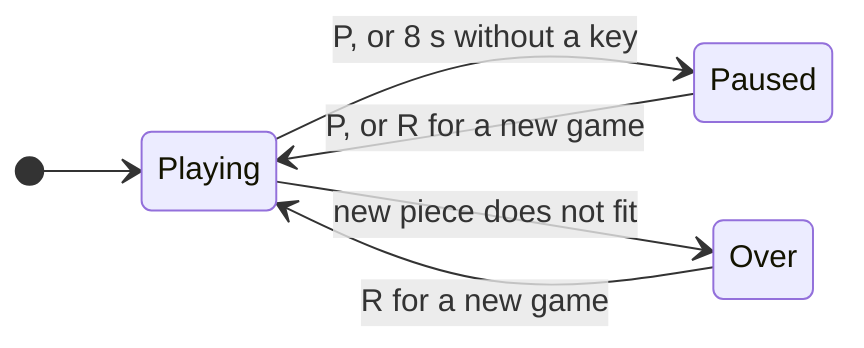

# Controls and timing

This page covers everything the keyboard does and every duration in the game.
Read it before you change how a key behaves or tune a delay.

## Keys

The program reads seven keys. They cannot be remapped.

| Key | Action | Active when | Read in |
| --- | --- | --- | --- |
| Left, Right | Move the piece one column. Repeats while held. | Playing | `Game::update`, `Game::sidestep` |
| Up | Rotate the piece once. | Playing | `Game::update` |
| Down | Soft drop: while held, the fall interval is `0.04` s. | Playing | `Game::update`, `Game::descend` |
| Space | Hard drop: move the piece down until it stops, and lock it. | Playing | `Game::update`, `Game::hard_drop` |
| P | Pause or resume. | Not over | `main` |
| R | Start a new game. | Over or paused | `main` |

"Playing" means the game is neither over nor paused. `main` calls `update` only
then, so a key pressed while the game is paused or over is not kept for later.

Up and Space act once per press; holding them does nothing more. A move or a
rotation that does not fit is refused: nothing moves on screen, and a low knock
is heard. See [Sound](sound.md#the-cue-sheet). A held key that keeps pushing at
a wall is silent.

### Staging keys

Built with `--features stage`, the game reads eight more keys while playing.
Each sets up a situation that random pieces would take minutes to produce.
What happens next is ordinary play. The game as shipped does not have them: the
feature is off by default.

| Key | Sets up |
| --- | --- |
| F1 to F5 | Rows about to clear, and a straight piece over the gap. A hard drop removes 1 to 5 rows. |
| F6 | A row count one short of the next level. |
| F7 | A well filled to the brim. The next lock ends the game. |
| F8 | An empty well, the piece back on its top row. |

They exist for the sound bench, which presses them and records what is heard,
and for trying a sound or an effect by hand: `cargo run --features stage`, then
F4 and Space. The code is `src/stage.rs`. See
[Development](../development.md#the-sound-bench).

## Left and Right

A press moves the piece one column at once. If the key stays down, the piece
waits, then moves again at a steady rate. This is key repeat.

`update` computes two directions, each `-1`, `0` or `1`: `pressed` from the keys
pressed this frame, and `down` from the keys held this frame. Right counts `+1`
and Left counts `-1`, so the two keys together give `0`.

- If `pressed` is not `0`, the piece moves one column and the field `held`
  returns to `0.0`.
- Otherwise, if `down` is not `0`, `held` grows by the frame time and the piece
  moves once for each repeat move now owed.
- Otherwise nothing happens.

So when Left and Right are held together, the piece does not move.

### Key repeat

| Constant | Value | Meaning |
| --- | --- | --- |
| `REPEAT_DELAY` | `0.17` s | Time a key is held before the first repeat move. |
| `REPEAT_RATE` | `0.05` s | Time between two later repeat moves. |

After the move on the press, repeat moves happen when `held` reaches 0.17 s,
0.22 s, 0.27 s and so on.

`Game::repeats(before, after)` returns how many repeat moves are owed when
`held` grows from `before` to `after`. It is `due(after) - due(before)`, where:

```text
due(t) = 0                                              if t < REPEAT_DELAY
due(t) = 1 + floor((t - REPEAT_DELAY) / REPEAT_RATE)    otherwise
```

A long frame owes every move it skipped: `repeats(0.0, 0.28)` is 3.

## Pause and restart

The game is in one of three states. The diagram shows what moves it from one to
another.



Two fields of `Game` hold the state:

| State | `over` | `paused` |
| --- | --- | --- |
| Playing | `false` | `false` |
| Paused | `false` | `true` |
| Over | `true` | `false` |

The rules, all in `main`:

- P flips `paused`, unless the game is over.
- R replaces the whole `Game` value with `Game::new()` when
  `Game::can_restart()` is true, that is when the game is over or paused. R does
  nothing during play. The comment on `can_restart` gives the reason: "R must
  not wipe a game in progress".
- A new game starts in the Playing state with an empty well, a score of zero and
  three new pieces.

While the game is paused or over, the piece does not fall and the five playing
keys do nothing.
The window is still drawn every frame.

## Automatic pause

The game pauses itself after `IDLE_PAUSE` = `8.0` s of play without a key.

Every frame, `main` calls `tick_idle` with the frame time and one fact: is any
key held down? `tick_idle` then does this:

- If a key is held, or the game is over or paused, the field `idle` returns to
  `0.0`.
- Otherwise `idle` grows by the frame time.
- If `idle` has reached `IDLE_PAUSE`, `paused` becomes true.

What follows:

- Any held key counts, including keys the game does not use.
- `idle` stays at `0.0` during a pause, so the player gets a full 8 s after
  resuming.
- An automatic pause is the same state as a pause with P. It shows the same
  overlay and ends with P, or with R for a new game.
- A game that is over is never paused.

## All timing values

Every timer advances by `get_frame_time()`. There is no fixed time step.

| Name | Value | Meaning | Used in |
| --- | --- | --- | --- |
| `REPEAT_DELAY` | `0.17` s | Hold time before the first repeat move. | `Game::repeats` |
| `REPEAT_RATE` | `0.05` s | Time between later repeat moves. | `Game::repeats` |
| `IDLE_PAUSE` | `8.0` s | Play time without a key before the automatic pause. | `Game::tick_idle` |
| literal `0.04` | s | Fall interval while Down is held. | `Game::update` |
| literal `0.6` | s | Fall interval at `level()` 0. | `Game::update` |
| literal `0.05` | s | Amount the fall interval shrinks per level. | `Game::update` |
| literal `0.08` | s | Shortest fall interval without soft drop. | `Game::update` |
| `GLOW` | `1.3` s | Time the level number stays highlighted. | `Game::draw_panel` |
| `GLOW_FADE` | `0.7` s | Last part of `GLOW`, during which the highlight fades. | `Game::draw_panel` |

The fall intervals per level are on [Game rules](game-rules.md#level-and-speed).
`GLOW` and `GLOW_FADE` are explained on
[Rendering and layout](rendering-and-layout.md#level-highlight). The durations
of all other effects are constants in `src/fx.rs`, listed on
[Effects](effects.md). The timings of the sound are constants in
`src/sound.rs`, listed on [Sound](sound.md#rules-of-the-desk). No effect and
no sound delays a key or a rule.
