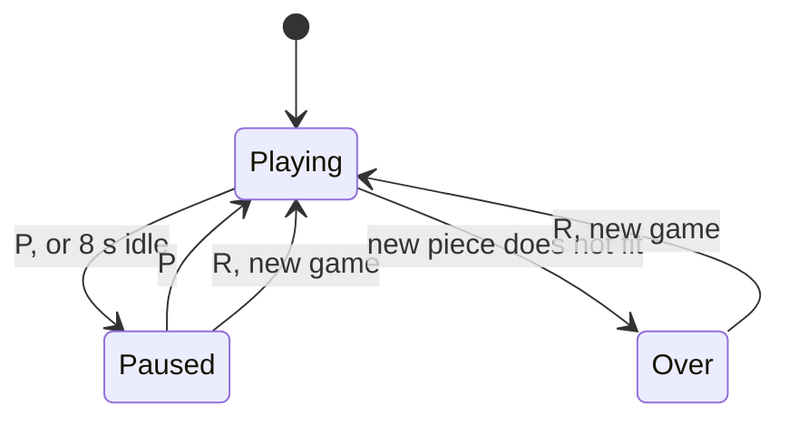

# Controls and timing

## Keys

The program reads seven keys by name. No key can be remapped.

| Key | Action | Read with | Where | Active when |
| --- | --- | --- | --- | --- |
| Left / Right | Move one column | `is_key_pressed`, then `is_key_down` for repeat | `Game::update` | Playing |
| Up | Rotate once | `is_key_pressed` | `Game::update` | Playing |
| Down | Soft drop: fall interval becomes `0.04` s | `is_key_down` | `Game::update` | Playing |
| Space | Hard drop and lock | `is_key_pressed` | `Game::update` | Playing |
| P | Toggle pause | `is_key_pressed` | `main` | Not over |
| R | Start a new game | `is_key_pressed` | `main` | Over or paused |

"Playing" means `over` and `paused` are both false; `main` calls `update` only
then. A key press that happens while the game is paused or over is not
remembered for later.

Rotation and hard drop act on the press only; holding Up or Space does not
repeat them. Down has no press action; it only changes the interval while held.

## Left and Right

`update` computes two values, each `-1`, `0` or `1`:

```rust
let pressed = is_key_pressed(KeyCode::Right) as i32 - is_key_pressed(KeyCode::Left) as i32;
let down = is_key_down(KeyCode::Right) as i32 - is_key_down(KeyCode::Left) as i32;
```

- If `pressed` is not zero: `held` is set to `0.0` and the piece moves one
  column in that direction.
- Otherwise, if `down` is not zero: `held` grows by the frame time and the
  piece moves once for each repeat step owed.
- Otherwise nothing happens. `held` is not reset when the key is released; it
  is reset by the next press.

When Left and Right are both held, `down` is `0` and the piece does not move.
When both are pressed in the same frame, `pressed` is `0` and no first move
happens.

A move that does not fit (`Game::shift` returns false) is dropped silently.

### Key repeat

| Constant | Value | Meaning |
| --- | --- | --- |
| `REPEAT_DELAY` | `0.17` s | Hold time before the first repeat move. |
| `REPEAT_RATE` | `0.05` s | Time between later repeat moves. |

`Game::repeats(before, after)` returns the number of moves owed when the hold
time grows from `before` to `after`. It is the difference of `due(after)` and
`due(before)`, where

```text
due(t) = 0                                              if t < REPEAT_DELAY
due(t) = 1 + floor((t - REPEAT_DELAY) / REPEAT_RATE)    otherwise
```

So after the first move on the press, repeat moves happen when the hold time
reaches 0.17 s, 0.22 s, 0.27 s and so on. A long frame owes every step it
skipped: `repeats(0.0, 0.28)` is 3.

## Pause and restart



The three states are encoded by two booleans of `Game`:

| State | `over` | `paused` |
| --- | --- | --- |
| Playing | false | false |
| Paused | false | true |
| Over | true | false |

Rules, all in `main`:

- P toggles `paused` unless the game is over.
- R replaces the whole `Game` value with `Game::new()` when
  `Game::can_restart()` is true, that is when `over || paused`. R does nothing
  during play; the doc comment on `can_restart` says "R must not wipe a game in
  progress".
- A new game starts in the Playing state with score, lines and timers at zero
  and three new random pieces.

While paused or over, `update` is not called: the piece does not fall and no
game key acts. `draw` is still called every frame.

## Idle auto-pause

| Constant | Value | Meaning |
| --- | --- | --- |
| `IDLE_PAUSE` | `8.0` s | Play time without any key before the game pauses itself. |

`main` calls `game.tick_idle(get_frame_time(), !get_keys_down().is_empty())`
once per frame. In `tick_idle`:

- If a key is active, or the game is over, or the game is paused, `idle`
  becomes `0.0`.
- Otherwise `idle` grows by the frame time.
- If `idle >= IDLE_PAUSE`, `paused` becomes true.

Points to note:

- "A key is active" means the set of held keys is not empty. Any key counts,
  including keys the game does not otherwise read.
- The count restarts while paused, so resuming gives a full 8 s.
- An automatic pause is the same state as a manual pause. It shows the same
  overlay and is left with P, or with R for a new game.
- A game that is over never becomes paused.

## All timing constants

| Name | Value | Used in | Purpose |
| --- | --- | --- | --- |
| `REPEAT_DELAY` | `0.17` s | `Game::repeats` | Delay before sideways repeat. |
| `REPEAT_RATE` | `0.05` s | `Game::repeats` | Period of sideways repeat. |
| `IDLE_PAUSE` | `8.0` s | `Game::tick_idle` | Idle time before auto-pause. |
| literal `0.04` | s | `Game::update` | Fall interval while Down is held. |
| literals `0.6`, `0.05`, `0.08` | s | `Game::update` | Start interval, change per level, floor. See [Game rules](game-rules.md). |
| `FLASH` | `0.25` s | `Game::lock`, `Game::draw_overlay` | Fade time of the cleared-row band. |
| `GLOW` | `1.3` s | `Game::lock` | Duration of the level highlight. |
| `GLOW_FADE` | `0.7` s | `Game::draw_panel` | Final part of `GLOW` spent fading. |

All timers advance by `get_frame_time()`. There is no fixed time step.
