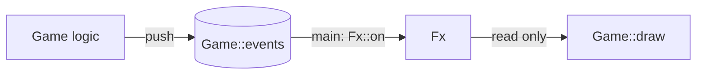

# Effects

This page describes the motion, light and fragments that answer what the player
does. Read it before you tune an effect, add one, or change what the game
reports.

## The idea

Game logic does not know that effects exist. When something happens, it pushes
an `Event` onto `Game::events`. Once per frame, `main` hands those events to an
`Fx` value, ages it by the frame time, and passes it to `Game::draw`.

The diagram shows that data moves one way: nothing returns from `Fx` to `Game`.

Three rules follow, and the code keeps them by construction:

- **Effects cannot change the game.** `Fx::on` takes an `Event` by value and
  `Fx` holds no reference to `Game`. No game rule reads `events` or `Fx`.
- **Effects never wait.** The well is updated at once, as before. An effect
  only changes where and how things are drawn for a short time.
- **Effects do not depend on the frame rate.** Every effect is computed from
  its age in seconds. Fragments follow a formula of their age; they are not
  moved step by step.

`Fx` has its own small random generator for fragments. It does not call
macroquad's generator, so effects do not change which pieces come next.

## Events

`Event` is declared in `src/main.rs`. `src/fx.rs` holds everything else on this
page. The same events drive the [sound](sound.md).

| Event | Pushed by | When | Carries |
| --- | --- | --- | --- |
| `Moved` | `Game::shift` | The piece moved: a key, a repeat move or one row of falling. Not when the move was refused. | `dx`, `dy` in cells. |
| `Rotated` | `Game::rotate` | The piece turned. Not when the turn was refused. | The kick, `dx` and `dy` in cells. |
| `Blocked` | `Game::sidestep`, `Game::rotate` | A key press asked for a sideways move or a turn that had no room. Not for a held key that keeps pushing at a wall. | Nothing. |
| `SoftDropped` | `Game::descend` | The row the piece has just fallen, already reported by `Moved`, fell with Down held. | Nothing. |
| `HardDropped` | `Game::hard_drop` | Space. `Locked` always follows. | `rows`: how far the piece dropped. |
| `Locked` | `Game::lock` | The piece became part of the stack. | Its `cells` in the well, its `color`, the rows `cleared`, the well `before` those rows were removed, and the `points` gained. |
| `LevelUp` | `Game::lock` | The lock raised the level. | The new `level`, counted from 0. |
| `GameOver` | `Game::lock` | The next piece does not fit. | Nothing. |

`Locked` carries the well as it was with the piece in it and the full rows
still there. The effects need it to draw the removed rows and to find which
cells the piece came to rest on.

`Blocked` and `SoftDropped` start no effect. They are heard, not seen.

## What each event starts

All positions are in the fixed view of
[Rendering and layout](rendering-and-layout.md#the-fixed-view). All effects
stay inside the well, except the three in the side panel.

### Moving and turning

The real piece moves at once. The drawn piece starts where it was and closes
the gap: 85% of it in 50 ms. A turn is drawn the same way, from a quarter turn
back. A turned piece is also brightened for `0.09` s.

After a sideways move or a turn, a faint copy of the piece is drawn further
back along the motion. It fades as the piece arrives. Falling gets no such
copy: with Down held it would flicker above the piece on every row.

The landing outline uses the real position, not the drawn one. It answers a key
in the same frame.

A new piece starts half a cell above its spawn row and drops into place.

### Hard drop

| Effect | What is drawn | Lasts |
| --- | --- | --- |
| Trail | A streak above each column of the piece, from where it was to where it landed, in the colour of the piece. It shortens toward the piece as it fades. | `0.20` s |
| Ring | The outline of the piece's bounds, growing by up to 22 units. | `0.26` s |
| Fragments | Two small squares from each bottom edge that touched something, at most ten. | up to `0.40` s |
| Knock | The whole well is drawn up to 4 units lower and comes back. The side panel does not move. | `0.16` s |

All four grow with the distance dropped and reach full strength at 10 rows. A
hard drop of zero rows starts none of them.

### Locking

Every lock, hard or not:

- The piece compresses toward its lowest edge: by 7% of its height when it
  settled, by up to 20% after a long hard drop. It takes `0.025` s to compress
  and `0.16` s to recover.
- Its cells are brightened for `0.14` s. The cells it rests on are brightened
  less.
- A line of light runs along each bottom edge that touched the floor or the
  stack, and spreads as it fades over `0.18` s. It is not drawn when the lock
  removes rows.

### Clearing rows

The well already holds the collapsed stack. For a short time it is drawn as it
was, and the change is played out:

| Step | From | What is drawn |
| --- | --- | --- |
| Sweep | `0` s | Two bright fronts leave the column where the piece closed the row and run to both walls at 120 cells per second. With several rows, the lowest goes first and each next row starts `0.012` s later. |
| Light | When a front reaches a cell | The cell turns white for `0.05` s. |
| Break-up | After the light | The cell shrinks away in `0.07` s and throws square fragments in its own colour. |
| Seam | With the sweep | A thin line where the row was, fading over `0.32` s. |
| Collapse | `0.17` s | The rows above come down to their real places in `0.15` s each. A row starts `0.008` s later for each row between it and the removed rows, up to 8. |
| Pulse | `0` s | The floor of the well brightens, and one line leaves the removed rows upward and another downward, over `0.5` s. They are drawn under the blocks. |
| Knock | `0` s | As for a hard drop. |

The number of rows sets the strength:

| Rows removed at once | 1 | 2 | 3 | 4 | 5 |
| --- | --- | --- | --- | --- | --- |
| Fragments per cell | 2 | 3 | 3 | 5 | 5 |
| Fragment speed, relative | 0.95 | 1.15 | 1.35 | 1.55 | 1.75 |
| Knock, in units | 2 | 3 | 4 | 5 | 6 |
| Reach of the pulse lines, in units | 105 | 160 | 215 | 270 | 325 |

### A lock during a clear

A fast player can lock the next piece before a clear has finished. The clear is
never cut: nothing on screen jumps.

| The new lock | What happens to the unfinished clear |
| --- | --- |
| Removes no row | It plays on 4 times faster (`HURRY`) and no longer waits before the collapse. The stack is where it really is within about four frames, and cells still lit get to break up. The piece that just locked is drawn where it landed from the first frame. |
| Removes rows too | The new clear replaces it and starts every row exactly where the old one was drawing it. That inherited offset is absorbed in `0.06` s (`INHERIT`). Cells of the old clear that had not broken up yet are dropped. |

Fragments already thrown carry on in both cases.

### Score and level

| Effect | What is drawn | Lasts |
| --- | --- | --- |
| Count-up | The score shown runs from the old value to the new one. `Game::score` itself changes at once. | `0.45` s |
| Tint | The score is drawn in the colour of the piece that scored, fading to `TEXT`. | `0.70` s |
| Gain | `+<points>` at the right end of the `SCORE` label line, in the same colour. | `1.0` s |
| Level change | The old level number leaves upward while the new one comes in from below. | `0.22` s |
| Level highlight | The new number in `COLORS[1]`, as described on [Rendering and layout](rendering-and-layout.md#level-highlight), with a line under it that widens and fades over `0.6` s. | `1.3` s |
| Level band | A soft band in `COLORS[1]` rises through the well, under the blocks. | `0.6` s |

### Higher levels

`LevelUp` also sets an energy value: the level divided by 10, at most 1. It
makes every later effect a little stronger and quicker, and adds nothing new:

| Scaled by energy | At energy 1 |
| --- | --- |
| Speed at which the drawn piece catches up | 1.5 times |
| Fragment speed, knock | 1.35 times |
| Brightness of the hard-drop trail | 1.3 times |

### Game over

| Step | From | What is drawn |
| --- | --- | --- |
| Hold | `0` s | The final state, untouched. Effects of the last lock finish. |
| Dimming | `0.45` s | The well darkens to the usual overlay level, from the top row down: each row starts `0.012` s after the one above and takes `0.4` s. |
| Box | `0.80` s | The game-over box fades in over `0.25` s, rising 10 units into place. |

R starts a new game at any moment of this sequence.

## Pause, restart and game over

| State | Effects |
| --- | --- |
| Paused | `main` does not call `Fx::tick`. Every effect stops where it is and resumes with the game. The pause overlay appears at once. |
| Over | `Fx::tick` keeps running, so the last effects finish and the ending plays. |
| Restart | `main` replaces `Fx` with `Fx::default()` together with the `Game`. Nothing carries over. |

## Tuning

Every duration and strength is a `const` at the top of `src/fx.rs`, grouped by
effect, or a literal in the function that draws the effect. Change them there.
The tests in `src/fx.rs` check behaviour, not exact values, so tuning does not
break them. See [Tests](tests.md#effects).

## Limits

| Behaviour | Cause |
| --- | --- |
| For up to about `0.4` s after rows are removed, the stack is drawn higher than it is. Collision and the landing outline use the real well during that time. A lock in that time shortens it to about four frames. | `Fx::block`, `Clear::row_dy` |
| When a clear replaces an unfinished one, the lit cells of the old one that had not broken up disappear without fragments. | `Fx::on` |
| A lock replaces the lock effect before it: with hard drops less than `0.2` s apart, the trail and ring of the earlier one end early. | `Fx::on` |
| The drawn piece trails the real one by a fraction of a cell while it moves. With Down held it locks before it has fully caught up; the lock effect carries the remaining offset and removes it smoothly. | `Fx::piece_pose`, `Fx::block` |
| At most 320 fragments exist at once. More are not created. Five rows need 300. | `MAX_SPARKS` |
| Fragments that would cross into the side panel or below the floor are not drawn. | `Fx::draw_over` |
