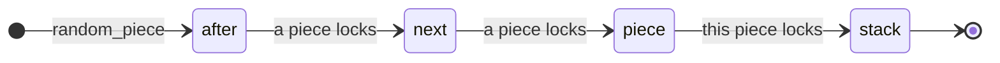

# Game rules

This page states the rules the code applies, with exact values. Read it to
learn how the game behaves, or to check a number before you change it. Keys are
on [Controls and timing](controls-and-timing.md); rotation has
[its own page](rotation-and-kicks.md).

## The rules in short

A piece appears at the top of the well and falls one row at a time. When it
cannot move down, it locks: its cells become part of the stack. Every row that
is then full is removed, and the rows above move down. Removing rows scores
points and, every 10 rows, raises the level. A higher level means a shorter
time between two downward steps. The game is over when the next piece does not
fit where it appears.

## The well

| Constant | Value | Meaning |
| --- | --- | --- |
| `W` | `12` | Columns, numbered 0 to 11 from the left. |
| `H` | `22` | Rows, numbered 0 to 21 from the top. |

The well is stored as `type Grid = [[u8; W as usize]; H as usize]` and indexed
`grid[row][column]`. The value `0` is an empty cell. Any other value is a locked
cell: 1, 2 or 3, the colour number of the piece it came from.

All 22 rows are visible. Nothing exists above row 0: `Game::fits` rejects a cell
whose row is outside `0..H` or whose column is outside `0..W`.

## How a piece is made

`random_piece()` makes every piece. A piece is a list of cells, each stored as
an offset `(column, row)` from the position `(x, y)` of the piece.

1. Choose the cell count `n` with `rand::gen_range(3, 6)`: 3, 4 or 5.
2. Start with the single cell `(0, 0)`.
3. Until the piece has `n` cells: choose one of its cells at random, choose one
   of the four directions at random, and add the neighbour in that direction
   unless the piece already contains it.
4. Place the piece at `x = W / 2`, which is column 6, and at the `y` that puts
   its topmost cell on row 0.
5. Set `color` to `n - 2`: 1 for three cells, 2 for four, 3 for five.

What follows:

- Every piece is connected edge to edge, because each new cell touches an
  existing one.
- Every piece contains the cell `(0, 0)`. It is the cell the piece turns
  around.
- A new piece covers columns 2 to 10 at most, so it always fits in an empty
  well.
- The colour depends only on the cell count, never on the shape.
- The code does not make shapes equally likely, does not treat mirror images
  as one shape and does not avoid repeating the previous shape.

`main` seeds the random generator once, with
`rand::srand(macroquad::miniquad::date::now() as u64)`. The seed is the clock in
whole seconds.

## Life of a piece

A piece is created two locks before the player controls it. The diagram shows
the three places a piece passes through; `after`, `next` and `piece` are fields
of `Game`.

`Game::new` calls `random_piece()` three times to fill `piece`, `next` and
`after`. From then on, each lock moves `next` into `piece` and `after` into
`next`, and puts a new piece in `after`. `next` and `after` are the two upcoming
pieces shown in the side panel.

## Falling

`Game::update` adds the frame time to the field `fall`. When `fall` reaches the
fall interval, `fall` returns to `0.0` and the piece moves down one row. If it
cannot move down, it locks.

| Situation | Fall interval |
| --- | --- |
| Down is held (soft drop) | `0.04` s, at every level |
| Otherwise | `(0.6 - 0.05 * level).max(0.08)` s. See [Level and speed](#level-and-speed). |

Three details:

- There is no separate lock delay. A piece resting on the stack can still be
  moved and rotated until the next downward step fails. Moving or rotating does
  not reset `fall`.
- A hard drop (Space) moves the piece down until it stops and locks it in the
  same frame.
- A lock sets `fall` to `0.0`, so each new piece waits one full interval before
  its first step.

## Locking and clearing rows

`Game::lock` does all of this, in this order:

1. Writes `piece.color` into the well at each cell of the piece.
2. Records in `cleared` the index of every row that has no empty cell.
3. Removes those rows. The rows above them move down by the same number of
   rows, and the same number of empty rows appear at the top.
4. Adds the number of removed rows to `lines`.
5. Adds the points to `score`. See [Scoring](#scoring).
6. Sets `flash` to `FLASH` if at least one row was removed, and `glow` to
   `GLOW` if the level rose. These two timers drive display effects described
   on [Rendering and layout](rendering-and-layout.md#display-timers).
7. Sets `fall` to `0.0`.
8. Moves `next` into `piece` and `after` into `next`, and puts a new
   `random_piece()` in `after`.
9. Sets `over` to true if the new `piece` does not fit at its position.

Rows move as whole rows. A locked cell never falls on its own into a gap below
it.

## Scoring

Only removing rows scores points. One lock that removes `n` rows adds
`n * n * 100` to `score`.

| Rows removed by one lock | Points |
| --- | --- |
| 0 | 0 |
| 1 | 100 |
| 2 | 400 |
| 3 | 900 |
| 4 | 1600 |
| 5 | 2500 |

Five is the most one lock can remove, because a piece has at most 5 cells. The
level does not multiply the points. A soft drop or a hard drop scores nothing.

## Level and speed

`Game::level()` returns `lines / 10`, rounded down. The side panel shows
`level() + 1`, so the player starts on level 1 while `level()` is 0.

| `level()` | Shown as | Rows removed so far | Fall interval (s) |
| --- | --- | --- | --- |
| 0 | 1 | 0 | 0.60 |
| 1 | 2 | 10 | 0.55 |
| 2 | 3 | 20 | 0.50 |
| 3 | 4 | 30 | 0.45 |
| 4 | 5 | 40 | 0.40 |
| 5 | 6 | 50 | 0.35 |
| 6 | 7 | 60 | 0.30 |
| 7 | 8 | 70 | 0.25 |
| 8 | 9 | 80 | 0.20 |
| 9 | 10 | 90 | 0.15 |
| 10 | 11 | 100 | 0.10 |
| 11 and above | 12 and above | 110 and above | 0.08 |

The level has no upper limit, but the fall interval stops at `0.08` s. The
soft-drop interval, `0.04` s, is shorter than that, so holding Down speeds the
piece up at every level.

## End of the game

`lock` ends the game when the piece it has just taken from `next` does not fit
at its position. No other code sets `over` to true. The piece that did not fit
stays in `piece` and is still drawn, under the game-over overlay.

The finished game stays in memory until the player presses R, which replaces it
with `Game::new()`. See [Pause and restart](controls-and-timing.md#pause-and-restart).
