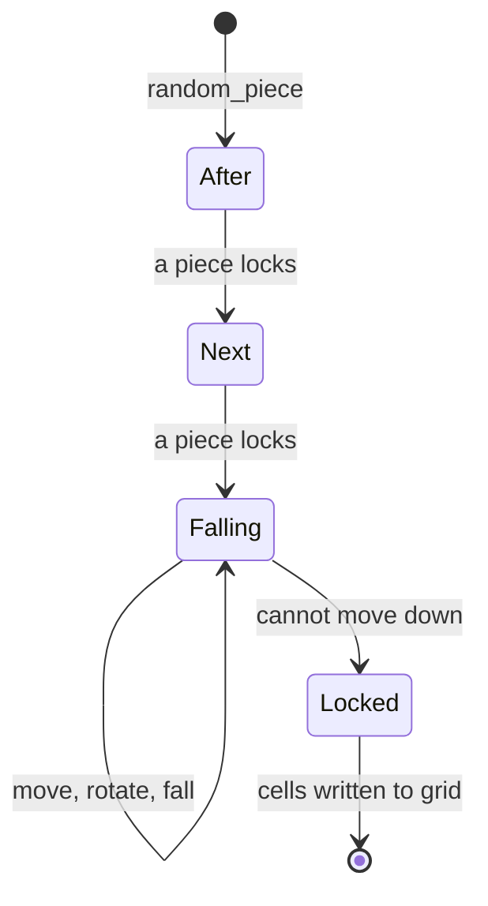

# Game rules

## The well

| Constant | Value | Meaning |
| --- | --- | --- |
| `W` | `12` | Columns, numbered 0 to 11 from the left. |
| `H` | `22` | Rows, numbered 0 to 21 from the top. |

The well is `type Grid = [[u8; W as usize]; H as usize]`, indexed
`grid[row][column]`. A value of `0` is an empty cell. Any other value is a
1-based index into `COLORS` (1, 2 or 3 in practice), written when a piece locks.

All 22 rows are visible. There is no hidden area above row 0: `Game::fits`
rejects any cell with a row outside `0..H` or a column outside `0..W`.

## Piece generation

`random_piece()` builds every piece. There is no fixed set of shapes.

1. The cell count `n` is `rand::gen_range(3, 6)`, that is 3, 4 or 5.
2. The shape starts as the single cell `(0, 0)`.
3. Until the shape has `n` cells: pick one existing cell at random, pick one of
   the four directions `(1, 0)`, `(-1, 0)`, `(0, 1)`, `(0, -1)` at random, and
   add the neighbour in that direction if the shape does not already contain
   it. If it does, nothing is added and the loop tries again.
4. The piece is placed at `x = W / 2` (column 6) and `y = -top`, where `top` is
   the smallest row offset in the shape. The topmost cell is therefore on row 0.
5. `color` is `n as u8 - 2`: 1 for three cells, 2 for four, 3 for five.

Properties that follow from this:

- Cells are stored as offsets from the piece position. `(0, 0)` is always
  present and is the rotation pivot.
- Every shape is connected edge to edge, because each new cell is a direct
  neighbour of an existing one.
- A shape has at most 5 cells, so no offset is further than 4 from the origin
  and a new piece occupies columns 2 to 10 at most. It always fits in an empty
  well; `random_pieces_spawn_inside_the_well` checks this on 1000 pieces.
- Nothing in the code makes the possible shapes equally likely, removes mirror
  images, or avoids repeating the previous shape.

The generator is seeded once in `main` with
`rand::srand(macroquad::miniquad::date::now() as u64)`. `date::now()` returns
seconds, so the seed changes once per second.

`Game::new` calls `random_piece()` three times, for `piece`, `next` and `after`.

## Life of a piece



`after`, `next` and `piece` are the three `Piece` fields of `Game`. A piece is
created in `after`, moves to `next` at the next lock and becomes the falling
`piece` at the lock after that. Its shape and colour are fixed at creation; only
rotation changes the cell offsets later.

## Falling

`Game::update` adds the frame time to `fall`. When `fall` reaches the current
interval, `fall` is set to `0.0` and the piece is shifted down one row with
`shift(0, 1)`. If that shift fails, the piece locks.

| Situation | Interval |
| --- | --- |
| Down is held | `0.04` s, at every level |
| Otherwise | `(0.6 - 0.05 * level).max(0.08)` s |

Details readable from the code:

- At most one row is descended per frame by gravity, and `fall` is reset to
  `0.0` rather than reduced by the interval. The real time between two steps is
  therefore the interval rounded up to a whole number of frames.
- There is no separate lock delay. A piece that rests on the stack locks at the
  next gravity step on which it cannot move down. Until then it can still be
  moved and rotated. Moving or rotating does not reset `fall`.
- A hard drop (Space) shifts the piece down until it stops and locks it in the
  same frame.
- `lock` sets `fall` to `0.0`, so every new piece starts a full interval.

## Locking and row clearing

`Game::lock` does the following, in this order:

1. Writes `piece.color` into the grid at each cell of the piece.
2. Collects `kept`, the rows that still contain at least one `0`.
3. Stores in `cleared` the indices of the rows that contain no `0`.
4. Reads the level before the change.
5. Empties the grid and copies `kept` into its last rows, in the same order.
   Rows above removed rows move down; the top rows become empty.
6. Adds the number of cleared rows to `lines`.
7. Adds `cleared * cleared * 100` to `score`.
8. Sets `flash = FLASH` if at least one row was cleared.
9. Sets `glow = GLOW` if the level is now higher than in step 4.
10. Sets `fall = 0.0`.
11. Moves `next` into `piece`, `after` into `next`, and puts a new
    `random_piece()` in `after`.
12. Sets `over` to true if the new `piece` does not fit at its position.

There is no gravity for individual cells after a clear: rows move as whole rows.

## Scoring

The only source of points is clearing rows. The score added by one lock is

```text
rows_cleared * rows_cleared * 100
```

| Rows cleared by one lock | Points |
| --- | --- |
| 0 | 0 |
| 1 | 100 |
| 2 | 400 |
| 3 | 900 |
| 4 | 1600 |
| 5 | 2500 |

Five is the largest possible value, because a piece has at most 5 cells. The
level does not multiply the score. Soft drops and hard drops give no points.
`score` and `lines` are `u32`.

## Level and speed

`Game::level()` returns `lines / 10` (integer division). The panel displays
`level() + 1`, so the first level is shown as 1.

The fall interval without soft drop is `(0.6 - 0.05 * level).max(0.08)` seconds.

| `level()` | Shown as | Lines needed | Interval (s) |
| --- | --- | --- | --- |
| 0 | 1 | 0 | 0.60 |
| 1 | 2 | 10 | 0.55 |
| 2 | 3 | 20 | 0.50 |
| 3 | 4 | 30 | 0.45 |
| 4 | 5 | 40 | 0.40 |
| 5 | 6 | 50 | 0.35 |
| 6 | 7 | 60 | 0.30 |
| 7 | 8 | 70 | 0.25 |
| 8 | 9 | 80 | 0.20 |
| 9 | 10 | 90 | 0.15 |
| 10 | 11 | 100 | 0.10 |
| 11 and above | 12 and above | 110 | 0.08 |

The level keeps rising after 11, with no upper bound in the code, but the
interval stays at the `0.08` floor. The soft-drop interval `0.04` is shorter
than the floor, so holding Down speeds the piece up at every level.

## End of the game

The game ends inside `lock`, when the piece taken from `next` does not fit at
its spawn position (`over = !self.fits(...)`). This is the only place `over` is
set to true. The blocked piece stays in `piece` and is still drawn by
`draw_well`, under the game-over overlay.

A game that is over stays in memory until R replaces it with `Game::new()`. See
[Controls and timing](controls-and-timing.md).
