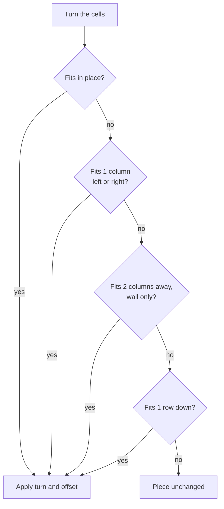

# Rotation and kicks

All rotation logic is in `Game::rotate`. It is called from `Game::update` when
Up is pressed.

## The turn

Each cell offset `(x, y)` of the piece becomes `(-y, x)`:

```rust
let turned: Vec<_> = self.piece.cells.iter().map(|&(x, y)| (-y, x)).collect();
```

Rows grow downward on screen, so this is a quarter turn clockwise as seen by
the player: the offset `(1, 0)` (right of the pivot) becomes `(0, 1)` (below
it).

- The pivot is the cell `(0, 0)`, which every piece contains. It is the first
  cell created by `random_piece`, not the centre of the shape.
- There is one direction of rotation. No key rotates the other way.
- Four turns with no kick restore the cell list and the position
  (`four_turns_restore_the_piece`).

## Kicks

The turned shape is tested with `Game::fits` at the piece position plus each of
these offsets, in this order. The first one that fits is applied: the piece
position moves by the offset and the cells are replaced by the turned ones. If
none fits, the piece is left unchanged.

| Order | `(dx, dy)` | Meaning | Condition |
| --- | --- | --- | --- |
| 1 | `(0, 0)` | In place | none |
| 2 | `(-1, 0)` | One column left | none |
| 3 | `(1, 0)` | One column right | none |
| 4 | `(-2, 0)` | Two columns left | `wall_only(-1)` |
| 5 | `(2, 0)` | Two columns right | `wall_only(1)` |
| 6 | `(0, 1)` | One row down | none |



### The wall-only rule

A two-column kick is skipped unless `wall_only(dx / 2)` is true. The closure
looks at the turned shape moved by one column in the same direction (`k` is
`-1` or `1`) and returns true when both of these hold:

- at least one cell has a column outside `0..W`;
- every cell is either outside the columns `0..W`, or outside the rows `0..H`,
  or on an empty grid cell.

In the words of the code comments: the one-column kick "was stopped by the side
wall alone", and two cells are allowed "only to clear a wall, never to hop over
stack blocks".

The condition only decides whether the two-column position is tried. That
position must still pass `fits`.

### Examples from the tests

| Test | Start | Result |
| --- | --- | --- |
| `rotation_kicks_off_walls_but_not_over_the_stack` (first part) | Cells `(0,0),(0,1)` at `(5, 10)`, locked blocks in columns 4 and 6 on rows 9 to 12 | No rotation: the one-column kicks hit blocks and the two-column kicks are refused by the wall-only rule. |
| same test (second part) | Cells `(0,-1),(0,0),(0,1),(0,2)` at `(0, 10)`, against the left wall | Rotates to `(1,0),(0,0),(-1,0),(-2,0)` and moves to `(2, 10)`: kick 5. |
| `top_row_piece_can_still_turn` | Cells `(0,0),(-1,0),(1,0)` at `(5, 0)` | Rotates to `(0,0),(0,-1),(0,1)` and moves to `(5, 1)`: kick 6. |

## Limits

- The code carries this note: `shortcut: a single row down, so a shape poking
  2+ rows above row 0 still refuses; add more rows if that matters`. A turned
  shape that would reach two or more rows above row 0 is not rotated, because
  only one downward row is tried.
- No kick moves the piece up. A turned shape that would go below row 21 or into
  the stack below is rotated only if a sideways kick makes it fit.
- The downward kick is tried last and is not combined with a sideways kick.
- A refused rotation gives no feedback: nothing is drawn or recorded.
