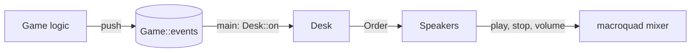

# Sound

This page lists what is heard, when and how loud. Read it before you change a
level, add a cue, or change what the game reports.

## The idea

Sound works like the [effects](effects.md). Game logic pushes an `Event`. Once
per frame `main` hands each event to a `Desk`, then lets the `Speakers` play
what the desk ordered.

The diagram shows that data moves one way: nothing returns from sound to the
game.

The work is split in two so that it can be tested:

| Part | What it is | Tested |
| --- | --- | --- |
| `Desk` | The mixing desk. Plain computation on events and elapsed time. It decides which cue plays and how loud, and writes `Order` values. | Yes, without a sound card. |
| `Speakers` | Loads every file once, at start, and carries the orders out through `macroquad::audio`. | No. It needs a sound card. |

Three rules follow, and the code keeps them by construction:

- **Sound cannot change the game.** `Desk::on` takes an event by reference and
  the desk holds no reference to `Game`. No game rule reads the desk.
- **Sound never waits.** A cue starts with the event. Nothing in the game is
  delayed for a sound to finish.
- **Every key is answered.** A move, a turn, a drop and a pause each have a
  cue. So has a key press that could not be obeyed.

## Two materials

Every cue is made from one of two materials, so the ear can tell what kind of
thing happened.

| Material | Sounds like | Used for |
| --- | --- | --- |
| Contact | Dry, short, without pitch or low: ticks, knocks, a thump. | What the piece physically does: a step, a turn, a bump, a run down, a lock, a hard drop. |
| Glass | A struck bar, tuned: three sine partials at 1, 2.76 and 5.40 times the pitch. | What the rules do: rows clear, pause, resume, new game. |

Every tuned note is a D, an E or an A. Those three notes sit over every chord
of the theme, so a cue never sounds wrong against the bar it lands on. The
level-up cue follows the same rule.

## The cue sheet

"Balance" is the cue's number in `level()`: the factor on its file that sets it
against the other sounds. Every cue then plays 3 dB lower than its balance, by
the factor `MASTER`: see [Room in the mix](#room-in-the-mix). "Peak" is the
highest sample as the game plays the cue. "Against the theme" compares the
cue's loudest 100 ms with an ordinary moment of the theme, both K-weighted;
the two music cues use 400 ms.

| Cue | Starts when | What is heard | Balance | Peak, dBFS | Against the theme, dB |
| --- | --- | --- | --- | --- | --- |
| `SoftDrop` | A row falls with Down held (`SoftDropped`). | A loop of soft ticks, one every 46 ms, until the rows stop. | 0.16 | -21.9 | -15.1 |
| `MoveLeft`, `MoveRight` | The piece moves one column (`Moved`). | One tick. Left is lower and to the left, right higher and to the right. | 0.32 | -15.9 | -9.9 |
| `Rotate` | The piece turns (`Rotated`). | A click, then a tone that rises a fifth and stops. | 0.40 | -13.9 | -4.1 |
| `Blocked` | A key press could not move or turn the piece (`Blocked`). | A dull, low knock. | 0.28 | -17.0 | -4.5 |
| `Lock` | The piece joins the stack (`Locked`). | A wooden knock with a low body. | 0.53 | -11.4 | -1.7 |
| `HardDrop` | The lock that follows a hard drop (`HardDropped`). | Added to `Lock`: a thump falling to a low D, the air it pushes out, a crack. | up to 0.79 | -8.1 | +4.9 |
| `Clear1` to `Clear5` | The lock removes 1 to 5 rows (`Locked`). | One glass note per row, climbing. See [Row clears](#row-clears). | 0.35 to 0.70 | -15.1 to -9.0 | +1.9 to +10.3 |
| `LevelUp` | The level rises (`LevelUp`). | The theme's three cells run upward in half a second, into an open chord. | 0.40 | -14.1 | +2.8 |
| `GameOver` | The next piece has no room (`GameOver`). | The motif, slower and lower. It replaces the theme. | 0.70 | -11.5 | +4.7 |
| `Pause`, `Resume` | The game pauses or resumes, by P or by itself. | Two glass notes: down for pause, up for resume. | 0.20 | -20.0 | -3.8 |
| `NewGame` | R starts a new game. | Three glass notes, rising. | 0.22 | -19.1 | -0.9 |
| `Theme` | The game starts, and at every new game. | The looping theme. | 0.60 | -10.9 | 0 |

`python3 tools/sound/bench.py sheet` prints this table from the files and the
levels as they are. Run it after changing either.

`Moved` with a row down and nothing sideways makes no sound. A piece that falls
by itself is silent; `SoftDropped` is what marks a row as the player's.

## Rules of the desk

### Moves

| Rule | Value | Reason |
| --- | --- | --- |
| Two ticks are never closer than `MOVE_GAP`. | `0.09` s | [The mixer](#the-mixer) starts sounds 93 ms apart at best. Two moves inside one block would be heard as one tick, twice as loud. A held key therefore ticks on every other column. |
| A move within `REPEAT_WINDOW` of the one before is a repeat. | `0.075` s | A held key repeats every 50 ms. A new press cannot follow that fast. |
| A repeat plays at `REPEAT_LEVEL` of the level. | `0.7` | The press is the event; the run that follows it is quieter. |

### Soft drop

The first `SoftDropped` starts the loop. It plays until `SOFT_TIMEOUT`
(`0.15` s) passes with no further row, or until the piece locks, whichever
comes first. The frame in which a row fell does not count toward the timeout,
so one slow frame does not stop a run that is still going.

### Lock and hard drop

`Lock` plays on every lock, at 0.84 of its level for a piece of 3 cells, 0.92
for 4 cells and at its full level for 5 cells.

A lock that follows `HardDropped` adds `HardDrop`, scaled by `drop_power`:
0.3 for a drop of zero rows, rising to 1 at 10 rows. The trail and the ring
drawn on screen use the same function.

### Row clears

Each count of rows has its own file. The notes climb D, A, D, E, A, one per
row, 42 ms apart, so the count can be heard.

| Rows | Notes | Added | Length | Theme lowered by |
| --- | --- | --- | --- | --- |
| 1 | D | A sweep, a few fragments, a low thud when the stack lands. | 0.4 s | 0 dB |
| 2 | D A | The same, more of each. | 0.4 s | 1.5 dB |
| 3 | D A D | The same, more of each. | 0.5 s | 3 dB |
| 4 | D A D E | A held open chord and a longer room. | 1.0 s | 5 dB |
| 5 | D A D E A | The chord an octave deeper, one more note above. | 1.6 s | 6 dB |

The theme goes down at once, stays down for `DUCK_HOLD` (`0.25` s) and comes
back at `DUCK_RELEASE` (5 dB per second). Of two ducks at once, the deeper and
the longer win.

### Level up

`LevelUp` plays its cue and lowers the theme by 4 dB for 1.8 s, the time the
cue's chord hangs. A level only rises on a row clear, so the cue starts with a
quarter second of near silence: the clear is heard first.

### Game over

`GameOver` stops the theme and a level-up cue from the same lock, then plays
its own cue. Nothing changes the theme's volume after that.

### Pause and resume

`Desk::frame` is called every frame with `Game::paused`. It acts when the value
changes, so P and the automatic pause sound the same.

| Change | What happens |
| --- | --- |
| Pause | Every cue but the theme is stopped. `Pause` plays. The theme fades to silence in `FADE_OUT` (`0.2` s) and plays on unheard: macroquad cannot pause a sound. |
| Resume | `Resume` plays. The theme fades back in `FADE_IN` (`0.3` s). |

A pause during a row clear finds the theme lowered. The theme fades out from
there. Its lowering is no longer held, and lets go at `DUCK_RELEASE` as usual:
were it dropped at once, the theme would jump up before it fades.

### New game

`Desk::restart` stops every cue, starts the theme from its first bar and plays
`NewGame`.

## The mixer

Two facts about macroquad's mixer (the `quad-snd` crate, version 0.2.8) shape
the rules above.

**It works in blocks of 4096 samples at 44100 Hz, 93 ms each.** An order to
play is carried out at the start of the next block. So:

- A sound starts up to 93 ms after its event, on top of the delay of the
  sound card. Recorded on a virtual sound card with a buffer of 20 ms, a key
  press was heard 25 to 105 ms later.
- Two sounds ordered within one block start on the same sample. A lock, its
  hard drop and its row clear are ordered together, so they stay together.
- A looped sound must last a whole number of blocks. When a loop ends inside a
  block, the mixer writes the beginning of the next pass at the start of that
  block, on top of the end of the last one, and leaves the rest of the block
  silent. This was measured on the theme before its length was changed: its
  first 18.5 ms played 74 ms early, and 18.5 ms of silence followed. The theme
  is now 1081 blocks long and the soft-drop loop 4 blocks.

**It adds every sound up and has no limiter.** A sum above full scale is
clipped by the sound card. The levels have to leave the room themselves.

### Room in the mix

A lock, its hard drop, a row clear, a level-up and a key or two pressed in the
same 93 ms all start on one sample. At their balance alone, the highest such
pile passes full scale by 1.5 dB. So `level()` multiplies every balance by
`MASTER`, 0.71, which is 3 dB. The whole game plays that much quieter and the
balance between its sounds is untouched.

How much room that leaves cannot be read off the peaks: two attacks can cancel
as well as add, and the theme is only loud in places. It can be counted,
though. Every sound starts on a block and the theme is 1081 blocks long, so a
group of cues meets the theme in 1081 ways and no more.
`python3 tools/sound/bench.py check` tries them all:

| Case | Highest peak |
| --- | --- |
| The theme alone | -10.9 dBFS |
| Everything that can start on one block, at the worst of its 1081 places in the theme | -1.5 dBFS |
| Two locks within a second, the second while the first still rings, at the worst place | -2.4 dBFS |
| Busy play made up at random, 12 times through the theme | -4.2 dBFS |
| The highest sample in the bench's recordings of the game | -6.0 dBFS |

The highest pile is a lock, a hard drop from 10 rows or more, one row cleared,
a turn and a refused key, 95.6 s into the theme.

## Checking the sound

The sound bench in `tools/sound` measures the files and the mix, and records
the running game to see what it played. Its manual is `tools/sound/README.md`.

| Command | What it does |
| --- | --- |
| `mise run sound-check` | Checks the files against what the mixer needs, and searches the mix for a sum over full scale. Five seconds, no sound card. |
| `mise run sound-record` | Runs the game on a virtual sound card, presses its keys, and compares what was played with what each session expects. Three minutes, Linux only. |

Run the first after changing a level or a file, and the second before a commit
that touches `src/sound.rs`.

## Where the files come from

| Files | Written by | Rendered to |
| --- | --- | --- |
| `audio/theme.score`, `level_up.score`, `game_over.score` | `audio/compose.py` | `assets/*.ogg` |
| `audio/sfx/*.score`, one per effect | `audio/sfx.py` | `assets/sfx/*.wav` |

`mise run audio` renders all of them. See
[Development](../development.md#audio).

Every effect and the level-up cue peak at -3 dBFS in their file. The `TRIM`
table in `audio/sfx.py` sets that. The balance between sounds is not in the
files: it is the `level()` function.

The effects are WAV files because the soft-drop loop must keep its exact
length. The Ogg decoder macroquad uses adds up to 22 ms of silence at the end
of a short file. On a file as long as the theme it is exact.

## Changing the balance

To make a cue louder or quieter, change its number in `level()` in
`src/sound.rs`. Nothing needs rendering again. The tests in `src/sound.rs`
check behaviour, not exact levels, so a new balance does not break them. See
[Tests](tests.md#sound).

Then run `mise run sound-check`. A louder cue takes room from the top of the
mix; if the check finds a sum over full scale, lower `MASTER`.

To change what a cue sounds like, change its function in `audio/sfx.py`, run
it, run `mise run audio`, and commit the script, the scores and the files
together.

## Limits

| Behaviour | Cause |
| --- | --- |
| The levels were set from measurements, not by ear. | `level` |
| `MASTER` leaves room for everything that can start on one block and for two locks in a row. Three or more events piling up are only sampled, not counted through. | `MASTER`, `tools/sound/bench.py` |
| On Windows the room is smaller: where blocks vary in length a pile can meet the theme anywhere, and the highest one then stops 0.1 dB short of full scale. | `quad-snd` |
| `Blocked` stands out from the theme only between 125 and 160 Hz. Speakers that do not play that low leave little of it. | `audio/sfx.py` |
| A sound starts up to 93 ms late and is never closer than 93 ms to the one before it. | The mixer's block size. |
| On Windows the mixer's blocks vary in length, so a loop can still end inside a block there. | `quad-snd` |
| A row clear's thud is fixed at 0.27 s into its file. When a second piece locks during the clear, the stack lands sooner on screen than in the sound. | `audio/sfx.py` |
| A pause cuts every cue. After a resume, an effect frozen in mid-animation continues without its sound. | `Desk::frame` |
| In the theme's loudest bars, the quietest cues (`SoftDrop`, `MoveLeft`, `MoveRight`) are partly covered by the music. | `level` |
| With no sound card, macroquad prints `Audio thread died` for every order. | `quad-snd` |
